# Exception Handling — Class Diagram (Requerimiento 6)

This diagram shows the new exception hierarchy, the new validation layer, and how
both integrate with the existing service and UI layers.

```mermaid
classDiagram
    class RuntimeException {
        <<java.lang>>
    }

    class GameZoneException {
        -String errorCode
        +GameZoneException(String message)
        +GameZoneException(String message, String errorCode)
        +getErrorCode() String
    }

    class ResourceNotFoundException {
        +ResourceNotFoundException(String resourceType, String identifier)
    }

    class BusinessRuleException {
        +BusinessRuleException(String message)
    }

    class InvalidDataException {
        +InvalidDataException(String fieldName, String problemDescription)
    }

    class PersistenceException {
        +PersistenceException(String message, Throwable cause)
    }

    RuntimeException <|-- GameZoneException
    GameZoneException <|-- ResourceNotFoundException
    GameZoneException <|-- BusinessRuleException
    GameZoneException <|-- InvalidDataException
    GameZoneException <|-- PersistenceException

    class ProductValidator {
        <<validation>>
        +validateProductData(String id, String title, double price, int stock)$
        +validateStockAvailability(Product product, int requestedQuantity)$
        +validateProductExists(Product product, String productId)$
    }

    class PersonValidator {
        <<validation>>
        +validatePersonData(String id, String name, String email, String phone)$
        +validatePersonExists(Person person, String personId)$
        +validateUniquePerson(List~Person~ existing, String newId)$
    }

    class SaleValidator {
        <<validation>>
        +validateSaleData(Customer customer, Seller seller, List~Product~ products)$
        +validateSaleExists(Sale sale, String saleId)$
    }

    ProductValidator ..> InvalidDataException : throws
    ProductValidator ..> BusinessRuleException : throws
    ProductValidator ..> ResourceNotFoundException : throws

    PersonValidator ..> InvalidDataException : throws
    PersonValidator ..> ResourceNotFoundException : throws
    PersonValidator ..> BusinessRuleException : throws

    SaleValidator ..> BusinessRuleException : throws
    SaleValidator ..> InvalidDataException : throws
    SaleValidator ..> ResourceNotFoundException : throws

    class ProductService {
        +reduceStock(String productId, int quantity)
        +findProductById(String productId) Product
    }

    class PersonService {
        +registerCustomer(...)
        +findCustomerByIdentification(String id) Customer
    }

    class SaleService {
        +registerSale(...)
        +findSaleById(String saleId) Sale
    }

    ProductService ..> ProductValidator : delegates validation to
    PersonService ..> PersonValidator : delegates validation to
    SaleService ..> SaleValidator : delegates validation to

    class ProductRepository {
        +loadAll() List~Product~
        +saveAll(List~Product~ products)
    }

    class PersonRepository {
        +loadAll() List~Person~
        +saveAll(List~Person~ people)
    }

    class SaleRepository {
        +loadSales() List~Sale~
        +saveSales(List~Sale~ sales)
    }

    ProductRepository ..> PersistenceException : wraps IOException as
    PersonRepository ..> PersistenceException : wraps IOException as
    SaleRepository ..> PersistenceException : wraps IOException as

    class ConsoleMenu {
        +run()
    }

    ConsoleMenu ..> ResourceNotFoundException : catches
    ConsoleMenu ..> BusinessRuleException : catches
    ConsoleMenu ..> InvalidDataException : catches
    ConsoleMenu ..> PersistenceException : catches
```

## How to read this diagram

- **Exception hierarchy** (top): `GameZoneException` extends Java's own
  `RuntimeException`, so it's unchecked. The four specialized exceptions all extend
  `GameZoneException` directly — they are siblings, not a deeper chain, which is
  why `ConsoleMenu` needs one `catch` per type instead of a cascade.
- **Validators** (`com.gamezone.validation`): static-method classes (marked `$` in
  Mermaid's notation for static members) that each service calls before touching
  the model or the repository. They throw the exceptions but never call a service
  or a repository themselves.
- **Services**: delegate their validation logic to the matching validator instead of
  throwing `IllegalArgumentException` inline.
- **Repositories**: catch `IOException` internally and re-throw it wrapped as
  `PersistenceException`, adding context (file name, operation) without exposing
  the raw `IOException` to callers.
- **`ConsoleMenu`**: the single point in the whole system that catches all four
  exception types, one `catch` block per type, to show a differentiated message to
  the user.